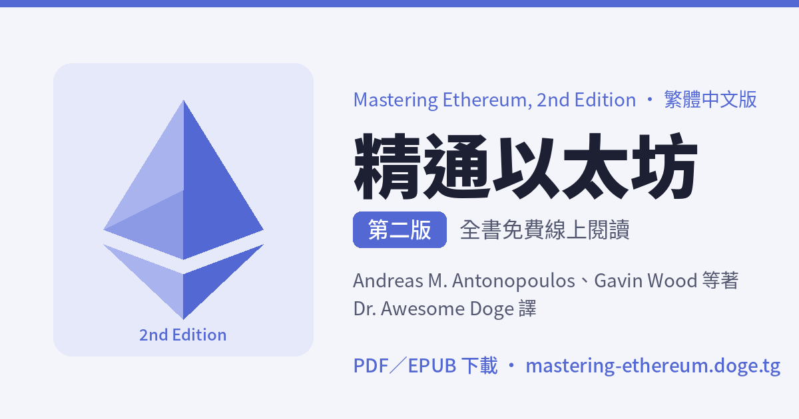

# 精通以太坊（第二版）Mastering Ethereum, 2nd Edition 繁體中文版

<p align="center">
  
</p>

<p align="center">
  <a href="https://mastering-ethereum.doge.tg/"><strong>線上閱讀</strong></a> ·
  <a href="https://github.com/awesome-doge/ethereumbook_zh/releases/latest">PDF／EPUB 下載</a> ·
  <a href="https://mastering-ethereum.doge.tg/2018/">2018 草稿譯本</a>
</p>

---

《精通以太坊》第二版（[Mastering Ethereum, 2nd Edition](https://github.com/ethereumbook/ethereumbook)）的繁體中文（臺灣）譯本，免費線上閱讀。
原著由 **Andreas M. Antonopoulos**、**Gavin Wood**、**Carlo Parisi**、**Alessandro Mazza** 與 **Niccolò Pozzolini** 撰寫，O'Reilly Media 於 2025 年出版；**Dr. Awesome Doge** 翻譯。

第二版依 The Merge 之後的以太坊全面改寫：權益證明、執行層與共識層客戶端、帳戶抽象、EIP-1559 與 blob 交易，並新增智能合約安全、去中心化金融（DeFi）、以太坊擴容（rollup、資料可用性）與零知識證明等章節。

## 閱讀方式

| 格式 | 說明 |
|------|------|
| [線上閱讀](https://mastering-ethereum.doge.tg/) | 每章一頁：全書目錄、全文搜尋、字級與主題切換、記住閱讀進度，支援桌面和手機 |
| [PDF 下載](https://github.com/awesome-doge/ethereumbook_zh/releases/latest/download/Mastering-Ethereum-2nd-Traditional-Chinese.pdf) | A4 排版，適合電腦、平板和列印 |
| [EPUB 下載](https://github.com/awesome-doge/ethereumbook_zh/releases/latest/download/Mastering-Ethereum-2nd-Traditional-Chinese.epub) | 適合 Kindle、Apple Books、Kobo 等電子書閱讀器 |

## 目錄

| 章節 | 主題 |
|------|------|
| [前言](https://mastering-ethereum.doge.tg/chapters/preface.html) | 寫作緣由、閱讀方式與排版慣例 |
| [第 1 章](https://mastering-ethereum.doge.tg/chapters/what-is-ethereum.html) | 什麼是以太坊？ |
| [第 2 章](https://mastering-ethereum.doge.tg/chapters/ethereum-basics.html) | 以太坊基礎 |
| [第 3 章](https://mastering-ethereum.doge.tg/chapters/nodes.html) | 以太坊節點 |
| [第 4 章](https://mastering-ethereum.doge.tg/chapters/cryptography.html) | 密碼學 |
| [第 5 章](https://mastering-ethereum.doge.tg/chapters/wallets.html) | 錢包 |
| [第 6 章](https://mastering-ethereum.doge.tg/chapters/transactions.html) | 交易 |
| [第 7 章](https://mastering-ethereum.doge.tg/chapters/solidity.html) | 智能合約與 Solidity |
| [第 8 章](https://mastering-ethereum.doge.tg/chapters/vyper.html) | 智能合約與 Vyper |
| [第 9 章](https://mastering-ethereum.doge.tg/chapters/smart-contract-security.html) | 智能合約安全 |
| [第 10 章](https://mastering-ethereum.doge.tg/chapters/tokens.html) | 代幣 |
| [第 11 章](https://mastering-ethereum.doge.tg/chapters/oracles.html) | 預言機 |
| [第 12 章](https://mastering-ethereum.doge.tg/chapters/dapps.html) | 去中心化應用 |
| [第 13 章](https://mastering-ethereum.doge.tg/chapters/defi.html) | 去中心化金融（DeFi） |
| [第 14 章](https://mastering-ethereum.doge.tg/chapters/evm.html) | 以太坊虛擬機（EVM） |
| [第 15 章](https://mastering-ethereum.doge.tg/chapters/consensus.html) | 共識 |
| [第 16 章](https://mastering-ethereum.doge.tg/chapters/scaling.html) | 以太坊擴容 |
| [第 17 章](https://mastering-ethereum.doge.tg/chapters/zero-knowledge-proofs.html) | 零知識證明 |

2018 年草稿（第一版）的舊譯本封存在 [/2018/](https://mastering-ethereum.doge.tg/2018/)，內容已過時；電子書見 [v2.0.0](https://github.com/awesome-doge/ethereumbook_zh/releases/tag/v2.0.0)。

## 專案結構

| 位置 | 內容 |
|------|------|
| `zh-tw/` | 第二版譯稿（Markdown），檔名與段落和上游一一對應 |
| `upstream/` | 上游英文原稿與圖片，釘在 `upstream/UPSTREAM_COMMIT` |
| `translation/` | 術語表、風格指南、各章進度與翻譯筆記 |
| `2018/` | 2018 草稿譯本（AsciiDoc） |
| `scripts/` | 譯稿轉換（`md2adoc.rb`）、譯稿與網站檢查、網站建置 |
| `web/` | 網站版型、樣式、腳本與各章 SEO 設定 |

翻譯計畫與各階段紀錄見 [TRANSLATION_PLAN.md](TRANSLATION_PLAN.md)，各章狀態見 [translation/progress.md](translation/progress.md)。

## 構建

```bash
# 安裝
gem install asciidoctor rouge nokogiri
brew install pandoc          # 譯稿 Markdown → AsciiDoc，需要 pandoc 3.x（CI 固定 3.13）
brew install webp            # 選用：圖片另外輸出 WebP（Linux：apt install webp）

# 檢查譯稿（與上游原稿的結構、術語、禁用詞）
ruby scripts/check-translation.rb --strict

# 構建整個網站到 output/（第二版在根部、2018 草稿譯本在 output/2018/、舊網址轉址頁），再檢查連結、錨點、sitemap 與標記外漏
ruby scripts/build-site.rb output
ruby scripts/check-site.rb output
python3 scripts/md2adoc/leaks.py output
python3 -m http.server 8000 --directory output   # 本機預覽 http://localhost:8000
```

推送到 `master` 會由 GitHub Actions 檢查、部署網站，並以 IndexNow 通知搜尋引擎有哪些頁面更新。推送 `v*` tag 會構建第二版的 PDF／EPUB 並發布到 GitHub Releases（流程見 `.github/workflows/ebook.yml`）。

## 授權

照原書現行條款以 [Creative Commons CC BY-NC-ND 4.0](https://creativecommons.org/licenses/by-nc-nd/4.0/deed.zh_TW) 釋出；原書出版 12 個月後轉為 [CC BY-SA 4.0](https://creativecommons.org/licenses/by-sa/4.0/deed.zh_TW)，本譯本屆時隨之更新。

[](https://creativecommons.org/licenses/by-nc-nd/4.0/)
